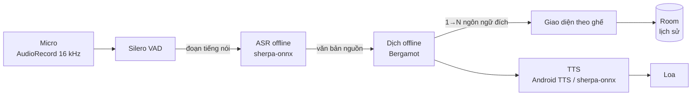
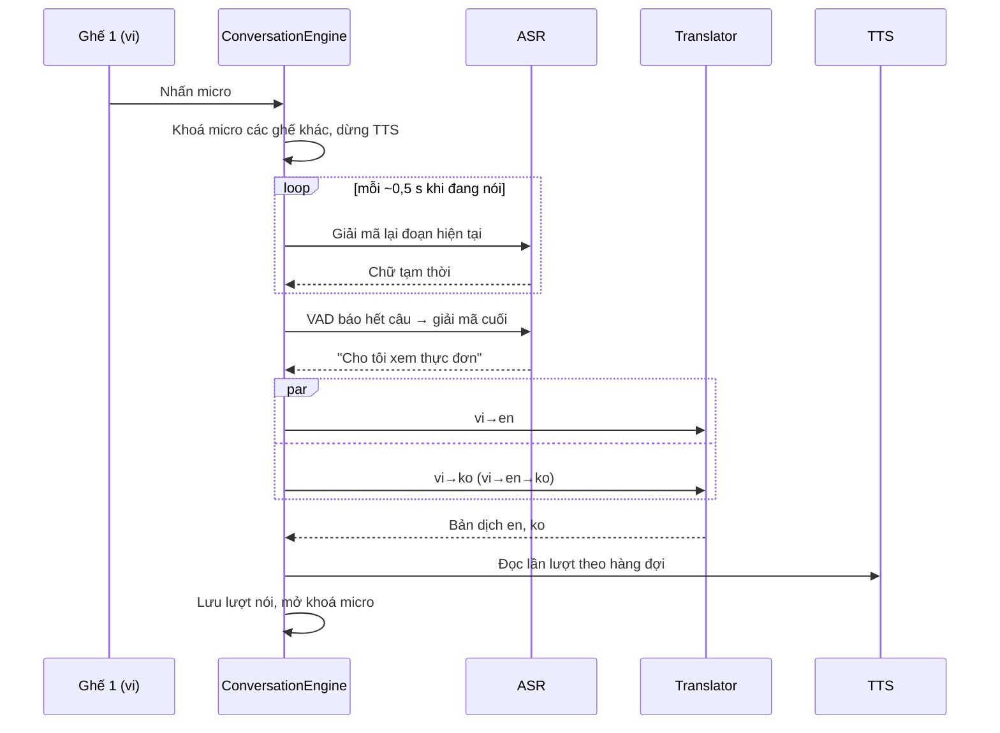

# Kiến trúc kỹ thuật — AI Translator (Android, offline)

> Phiên bản: 0.2 · Cập nhật: 2026-10-28 · Trạng thái: Đề xuất, chờ kiểm chứng ở Giai đoạn 0 (spike)
>
> Các con số dung lượng lấy từ trang phát hành chính thức (GitHub / Hugging Face / Mozilla) tại thời điểm viết.
> Độ chính xác và tốc độ trên điện thoại **chưa được đo** — sẽ đo ở Giai đoạn 0.

## 1. Nguyên tắc

1. **100% on-device:** âm thanh và văn bản không rời khỏi máy. Không có server ứng dụng → chi phí vận hành ≈ 0.
2. **Mã nguồn mở trước:** chỉ dùng thành phần đóng (vd Google ML Kit) làm mốc so sánh hoặc dự phòng.
3. **Thay được từng khối:** ASR, dịch, TTS nằm sau interface; đổi mô hình không ảnh hưởng UI.
4. **Tải theo nhu cầu:** APK nhỏ, mô hình tải về theo gói ngôn ngữ.
5. **Tôn trọng giấy phép:** mỗi mô hình kèm giấy phép và ghi nguồn hiển thị trong app.

## 2. Luồng xử lý



Trình tự một lượt nói (ví dụ phiên có 3 ngôn ngữ vi / en / ko):



## 3. Lựa chọn công nghệ

### 3.1 Nhận dạng giọng nói (ASR) — **sherpa-onnx** (Apache-2.0)

Một thư viện duy nhất có Kotlin API, chạy arm64, kèm sẵn Silero VAD, nhận diện ngôn ngữ nói và TTS.

| Ngôn ngữ | Mô hình đề xuất | Dung lượng | Ghi chú |
|---|---|---|---|
| vi | `zipformer-vi-30M-int8-2026-02-09` | ~26 MB | Ứng viên chính, nhỏ gọn |
| vi (dự phòng) | `zipformer-vi-int8-2025-04-20` (~70k giờ dữ liệu) | ~60 MB | So sánh độ chính xác ở spike |
| zh, en, ja, ko | `SenseVoice int8` (dùng chung 4 ngôn ngữ) | ~163 MB nén / 237 MB giải nén | Mã nguồn MIT; trọng số theo FunASR Model License (cho phép dùng, yêu cầu ghi nguồn) |
| VAD | Silero VAD | ~2 MB | |

- Các mô hình trên là **không streaming** → tạo "chữ tạm thời" bằng cách giải mã lại đoạn âm thanh đang có mỗi ~0,5 s
  (cách sherpa-onnx khuyến nghị với VAD + mô hình offline).
- Phương án khác để so sánh: whisper.cpp (MIT; base 142 MiB, small 466 MiB — chậm hơn), Vosk (Apache-2.0, mô hình nhỏ 30–80 MB, cũ hơn).
- Loại bỏ: mô hình Moonshine non-English bản cũ (giấy phép phi thương mại — cần kiểm tra lại nếu muốn dùng).

### 3.2 Dịch máy (MT) — **Mozilla Bergamot / Firefox Translations** (MPL-2.0)

| Tiêu chí | Đánh giá |
|---|---|
| Ngôn ngữ | Có vi, zh, ja, ko ↔ en |
| Dung lượng | en→vi ~32 MB, vi→en ~17 MB; en↔zh/ja/ko ~44 MB mỗi chiều (+1–9 MB từ vựng) |
| Tốc độ | Thiết kế cho CPU, chạy trong trình duyệt/Firefox Android → phù hợp điện thoại |
| Hạn chế | Chỉ có cặp với tiếng Anh → **vi↔zh/ko/ja phải đi qua tiếng Anh** (2 lần dịch, sai số cộng dồn) |
| Tích hợp | Repo `bergamot-translator` đã lưu trữ (12/2023); RTranslator 3.0 (Apache-2.0) đã tích hợp trên Android → tham khảo cách build JNI |

Các phương án so sánh ở Giai đoạn 0:

| Phương án | Ưu | Nhược | Vai trò |
|---|---|---|---|
| **Opus-MT** (Apache-2.0) qua ONNX Runtime | Có cặp **trực tiếp** zh→vi, ja→vi, en↔vi | ~290–310 MB/cặp (fp32), không có vi→zh/ja/ko | Thử thay thế cho zh→vi, ja→vi nếu pivot kém |
| **TranslateGemma 4B / Qwen 1.5–1.7B** qua LiteRT-LM hoặc llama.cpp | Dịch trực tiếp mọi cặp, hiểu ngữ cảnh, xưng hô tốt | 1–2+ GB, cần RAM ≥ 8 GB, chậm | "Chế độ chất lượng cao" v2 cho máy mạnh |
| **Google ML Kit** (miễn phí, mã đóng) | ~30 MB/ngôn ngữ, dễ tích hợp | Không mở, cũng pivot qua tiếng Anh | Mốc so sánh chất lượng |
| ~~NLLB-200~~ | — | CC-BY-NC, không dành cho production | Loại |
| ~~HY-MT1.5~~ | Chất lượng tốt | Giấy phép **loại trừ Hàn Quốc**, EU, UK | Loại |

### 3.3 Đọc bản dịch (TTS)

| Thứ tự | Giải pháp | Ghi chú |
|---|---|---|
| 1 | **Android `TextToSpeech`** của hệ thống | 0 MB thêm, giọng tự nhiên. Kiểm tra lúc chạy giọng offline có sẵn không (`isLanguageAvailable`, `Voice.isNetworkConnectionRequired`) và hướng dẫn người dùng tải |
| 2 | **Supertonic 3 qua sherpa-onnx** (dự phòng khi máy thiếu giọng offline) | 1 mô hình int8 ~130 MB cho vi/en/ko/ja (không có zh), OpenRAIL-M. Đã chạy trên máy thật ở spike: bắt đầu phát sau 1,0–1,8 s |

### 3.4 Khôi phục dấu câu & chữ hoa tiếng Việt

Mô hình ASR tiếng Việt chỉ ra CHỮ IN HOA không dấu câu, làm hỏng bản dịch ("XIN CHÀO" → "HANDSELEN").
Dùng **vibert-capu** (BERT tiếng Việt, int8 110 MB, CC-BY-SA-4.0 — phải ghi nguồn) qua ONNX Runtime: ~31 ms/câu trên
máy thật; quy tắc đơn giản làm dự phòng cho câu < 3 từ. Vì vậy app dùng bản sherpa-onnx **liên kết tĩnh ONNX Runtime**
cùng với `onnxruntime-android`.

### 3.5 Nền tảng ứng dụng

| Thành phần | Lựa chọn |
|---|---|
| Ngôn ngữ / UI | Kotlin, Jetpack Compose, Material 3 |
| Bất đồng bộ | Kotlin Coroutines + Flow |
| DI | Hilt |
| Lưu trữ | Room (lịch sử), DataStore (cài đặt) |
| Tải gói | WorkManager + OkHttp (tải tiếp khi rớt mạng, kiểm SHA-256) |
| Native | sherpa-onnx AAR; Bergamot qua JNI/NDK (CMake) |
| Build | Gradle Kotlin DSL, version catalog; `minSdk 28` (yêu cầu của Bergamot), ABI `arm64-v8a` (+ `x86_64` cho emulator) |
| CI | GitHub Actions: build, unit test, lint |

## 4. Cấu trúc module

```
app/                      Điều hướng, DI, theme
core/
  audio/                  AudioRecord, Silero VAD, quản lý focus/AEC
  asr/                    interface SpeechRecognizer + SherpaOnnxRecognizer
  translate/              interface Translator + BergamotTranslator + PivotTranslator
  tts/                    interface SpeechSynthesizer + AndroidTts + SherpaTts
  packs/                  Manifest gói, tải, kiểm tra, giải nén, quản lý dung lượng
  data/                   Room (Session, Turn, Translation), DataStore
  engine/                 ConversationEngine: máy trạng thái + điều phối pipeline
feature/
  conversation/           Bố cục 2/3/4 ghế, bong bóng, chữ lớn, bàn phím
  packs/                  Màn hình gói ngôn ngữ
  history/                Lịch sử, tìm kiếm, xuất
  settings/               Cài đặt, chẩn đoán, giấy phép
```

### Interface cốt lõi (phác thảo)

```kotlin
interface SpeechRecognizer {
    val language: Lang
    fun transcribe(audio: FloatArray, sampleRate: Int = 16_000): String
}

interface Translator {
    fun supports(from: Lang, to: Lang): Boolean
    suspend fun translate(text: String, from: Lang, to: Lang): String
}

interface SpeechSynthesizer {
    suspend fun speak(text: String, lang: Lang)
    fun stop()
}
```

`PivotTranslator` bọc một `Translator` khác: nếu không có cặp trực tiếp `from→to` thì dịch `from→en→to`.

### Máy trạng thái `ConversationEngine`

```
Idle ──nhấn mic ghế i──▶ Listening(i) ──VAD hết câu──▶ Recognizing ──▶ Translating ──▶ Speaking ──▶ Idle
   ▲                         │ nhấn lại / huỷ                                                │
   └─────────────────────────┘                          nhấn mic khi đang đọc (ngắt lời) ◀─┘
```

## 5. Gói ngôn ngữ

| Gói | Thành phần | Ước tính |
|---|---|---|
| core (luôn có) | Silero VAD | ~2 MB |
| vi | ASR zipformer-vi-30M + dấu câu vibert-capu + MT en↔vi | ~190 MB |
| tts-supertonic (tuỳ chọn) | TTS dự phòng vi/en/ko/ja khi máy thiếu giọng offline | ~130 MB |
| asr-sensevoice (dùng chung) | ASR zh/en/ja/ko | ~163 MB tải / ~237 MB giải nén |
| en | (ASR dùng SenseVoice) | ~0 MB thêm |
| zh / ja / ko | MT en↔X (2 chiều) | ~90–100 MB mỗi ngôn ngữ |

Tổng cho đủ 5 ngôn ngữ ≈ **660 MB** (chưa tính TTS dự phòng) — theo số đo spike.

**Manifest gói** (`packs.json`, phát hành kèm mỗi bản app hoặc trên GitHub Releases):

```json
{
  "id": "vi",
  "version": 1,
  "files": [
    { "url": "https://…/zipformer-vi-30M-int8.tar.bz2", "sha256": "…", "size": 26000000 }
  ],
  "licenses": ["Apache-2.0", "MPL-2.0"]
}
```

Nguồn tải: ưu tiên **mirror trên Hugging Face / GitHub Releases** do dự án quản lý (kèm file LICENSE gốc) để URL ổn định;
không phụ thuộc vào URL nội bộ của bên thứ ba.

## 6. Giai đoạn 0 — Spike kiểm chứng (trước khi làm MVP)

Mục tiêu: chốt mô hình dựa trên số liệu đo trên máy thật. App thử nghiệm, script và tiêu chí đạt nằm trong
[spike/README.md](../spike/README.md).

| Hạng mục | Cách làm |
|---|---|
| Bộ dữ liệu thử | ~100 câu du lịch/ngôn ngữ (gọi món, hỏi đường, giá cả, khách sạn, khẩn cấp); ghi âm bởi ≥ 3 người, gồm giọng Bắc/Trung/Nam cho tiếng Việt, có nhiễu nền |
| Thiết bị | 1 máy yếu (4 GB RAM), 1 tầm trung (6 GB), 1 cao cấp (8 GB+) |
| Đo ASR | WER/CER, thời gian giải mã, RAM — zipformer-vi-30M vs zipformer-vi-70k vs whisper base/small; SenseVoice cho zh/ja/ko/en |
| Đo dịch | chrF/COMET + đánh giá thủ công 1–5 — Bergamot (pivot) vs Opus-MT (zh→vi, ja→vi) vs ML Kit vs LLM nhỏ |
| Đo TTS | Độ phủ giọng offline của Android TTS trên các máy thử |
| Đầu ra | Bảng kết quả + quyết định cuối (cập nhật mục 3 của tài liệu này) |

## 7. Lộ trình

| Giai đoạn | Nội dung chính |
|---|---|
| 0. Spike | App thử nghiệm dòng lệnh/1 màn hình: đo ASR, dịch, TTS trên máy thật; chốt mô hình |
| 1. Nền tảng | Khung dự án đa module, CI, quản lý gói ngôn ngữ, interface ASR/MT/TTS |
| 2. MVP | 2 người, vi↔en, bấm-để-nói, chữ lớn, bàn phím, chẩn đoán độ trễ |
| 3. v1 | Đủ 5 ngôn ngữ, 3–4 ghế, rảnh tay + nhận diện ngôn ngữ, cụm từ du lịch, lịch sử & xuất; phát hành Google Play |
| 4. v2 | Chế độ chất lượng cao bằng LLM, ngữ cảnh hội thoại, tai nghe Bluetooth, cập nhật gói |

## 8. Dự án tham khảo

- [RTranslator](https://github.com/niedev/RTranslator) (Apache-2.0): dịch hội thoại offline trên Android — Whisper-Small,
  Bergamot / MADLAD / HY-MT, Silero VAD, TTS hệ thống. Khuyến nghị RAM ≥ 6 GB, lần tải đầu ~1,2 GB.
- [sherpa-onnx](https://github.com/k2-fsa/sherpa-onnx): ví dụ Android cho ASR, VAD, nhận diện ngôn ngữ, TTS.
- [mozilla/translations](https://github.com/mozilla/translations): pipeline và mô hình Bergamot.
